# 📚 지역 도서관 공공 사이트 — 도서 리스트 · 검색 파트

> Spring Boot 기반 시립 도서관 운영 플랫폼 (팀 프로젝트)
> 이 브랜치(`taeheun`)는 **오태흔**이 맡은 **도서 리스트 및 검색** 기능을 중심으로 정리한 문서입니다.

- **기간**: 2026.03.16 ~ 2026.03.26 (11일)
- **인원**: 7명 (백엔드 + 프론트 풀스택 분담)
- **담당**: 도서 데이터 수집, 도서 리스트, 검색 · 정렬 · 페이지네이션, 검색어 하이라이트, 상세보기 · 추천 · 찜, 대여 예약 로직, 공통 레이아웃

---

## 🖼 화면

### 도서 리스트

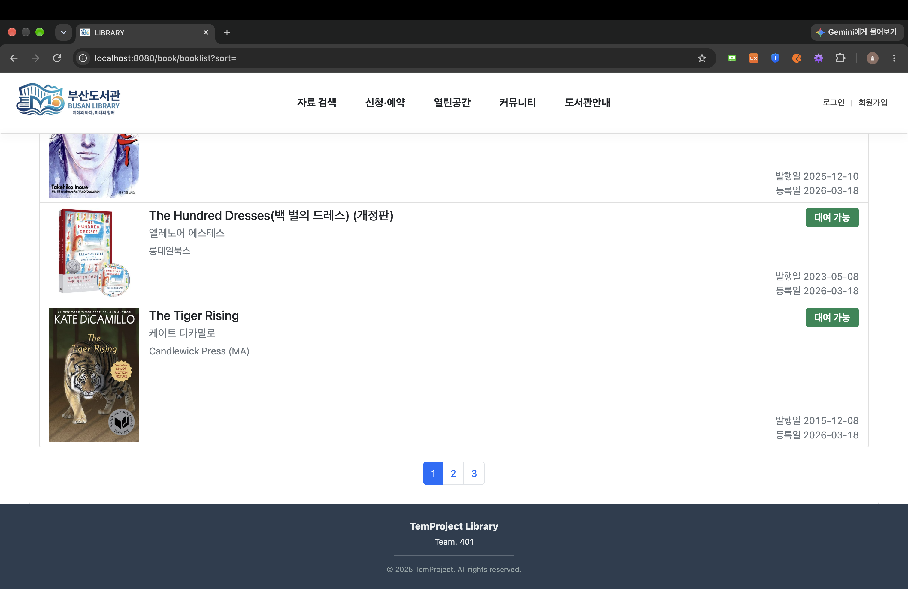
> 표지 · 저자 · 출판사 · 발행일/등록일과 **대여 가능 여부 배지**를 표시하고, 하단에 **페이지네이션**

### 검색

| 초성 검색 + 하이라이트 | 정규화 검색 (띄어쓰기 무시) |
|:---:|:---:|
| 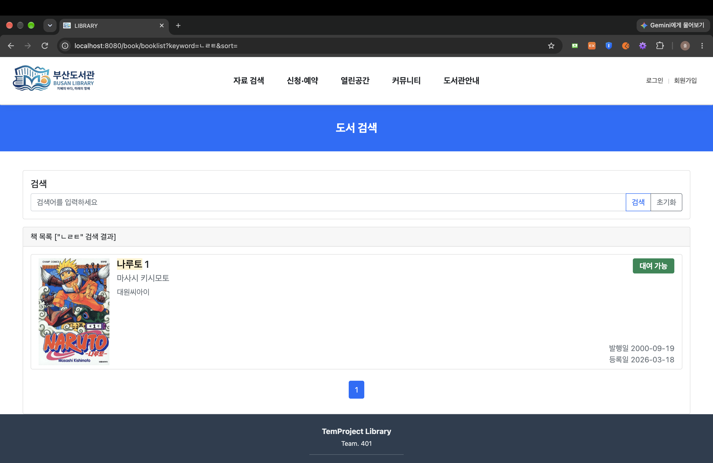 | 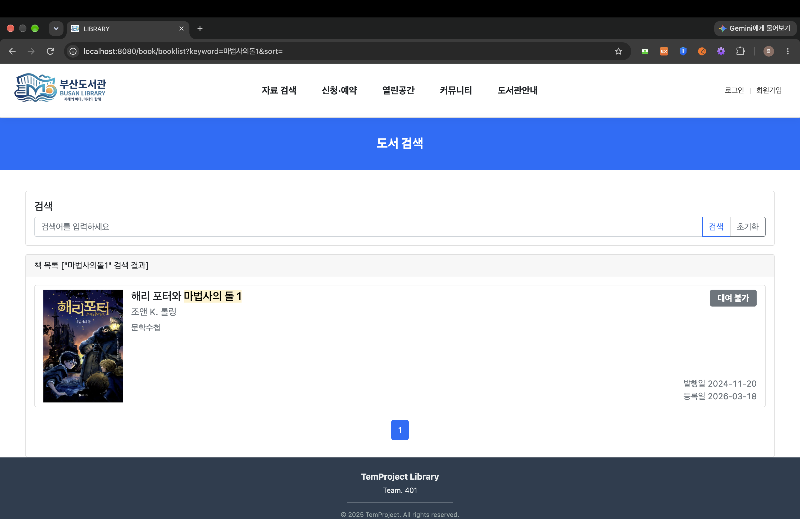 |
| `ㄴㄹㅌ` 입력 → **나루토** 위치에 마킹 | `마법사의돌1` 입력 → `해리 포터와 마법사의 돌 1` 매칭 |

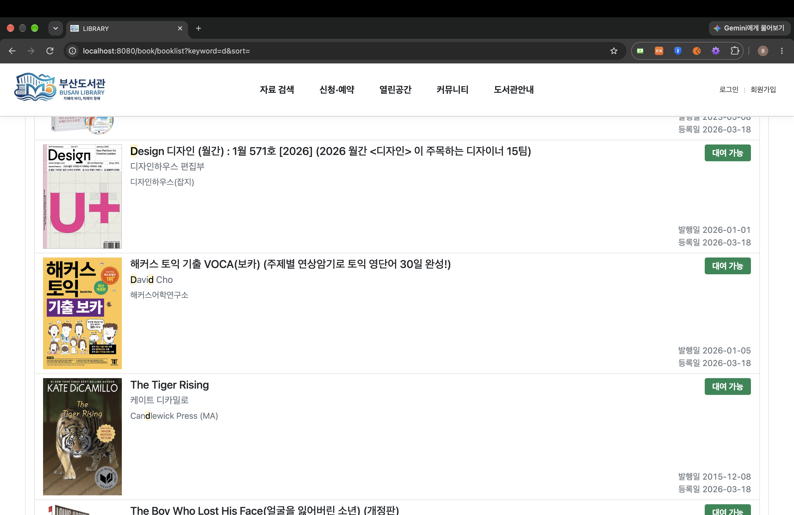
> **검색 우선순위**: `d`로 검색하면 **제목**(Design)이 일치한 결과가 먼저 나오고, 그다음 **저자**(David Cho), **출판사**(Candlewick Press) 일치 순으로 정렬

### 정렬

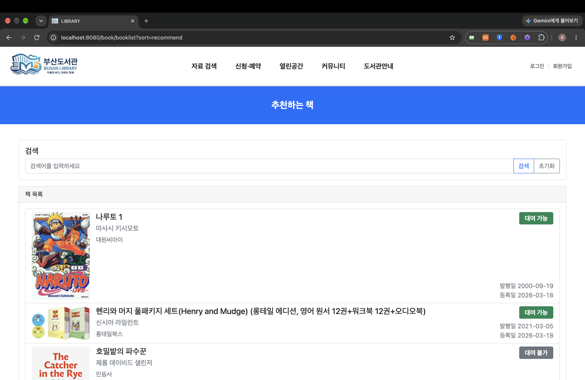
> 상단 메뉴 **자료 검색 → 새로들어온책 / 대출이많은책 / 추천하는책**으로 정렬하고, 페이지 타이틀도 정렬 기준에 맞게 변경

### 상세보기 · 추천

| 상세보기 모달 | 추천하기 |
|:---:|:---:|
| 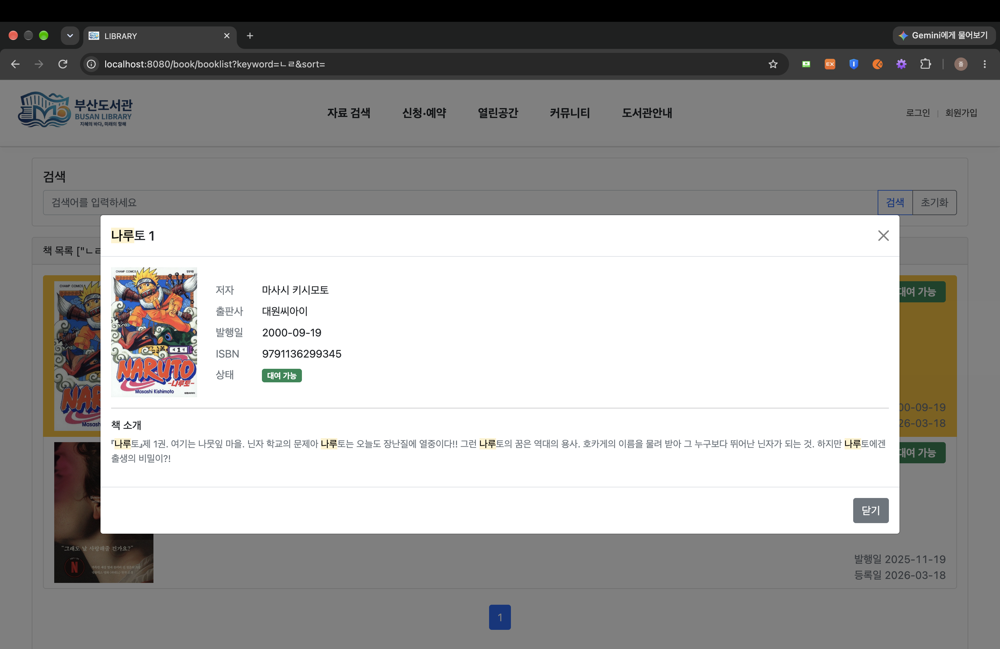 | 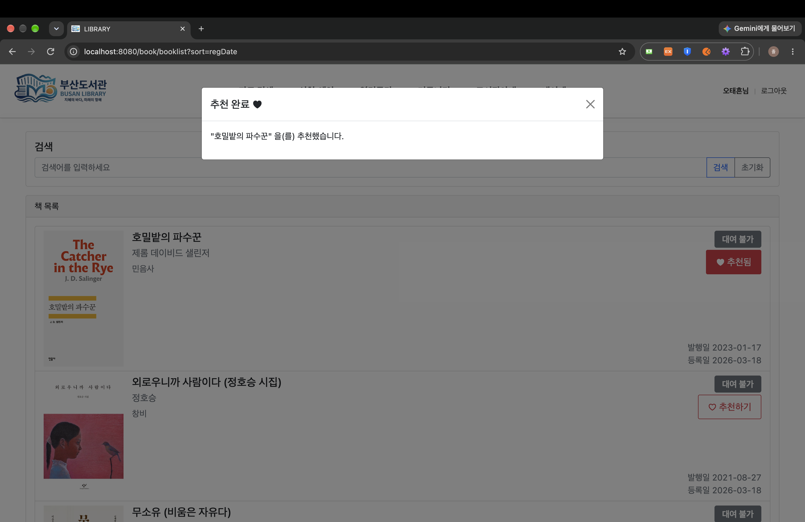 |
| 리스트의 검색어 하이라이트가 **모달의 제목 · 책 소개까지 유지** | 추천 시 완료 모달 표시, 버튼이 **♥ 추천됨**으로 전환 |

### 대여 예약

| 상세 모달 (대여 불가 도서) | 예약 완료 |
|:---:|:---:|
| 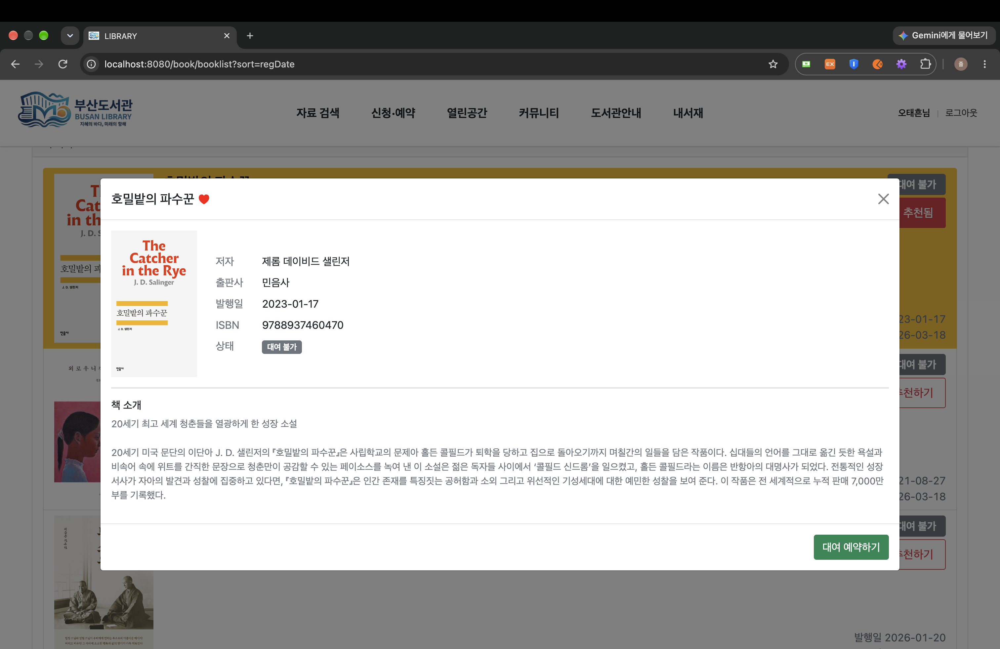 | 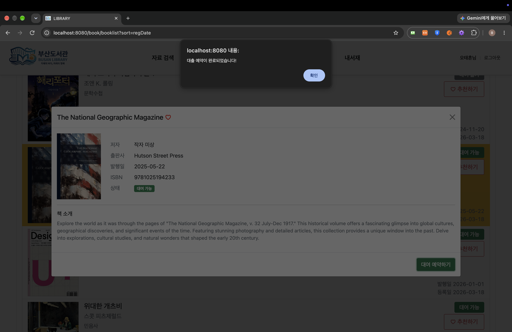 |
| 추천 상태(♥)를 제목 옆에 표시하고, 대여 불가 도서도 **대여 예약** 가능 | 예약 버튼 클릭 → 대출 예약 완료 |

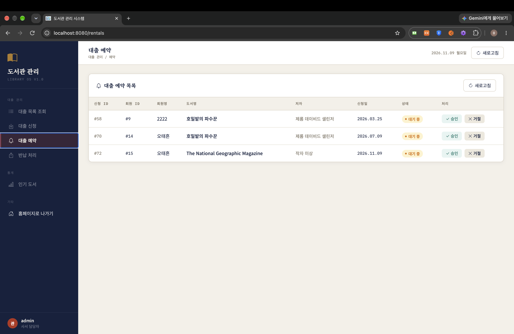
> 회원이 신청한 예약이 관리자 **대출 예약 목록**에 `대기 중` 상태로 반영됨

### 공통 레이아웃

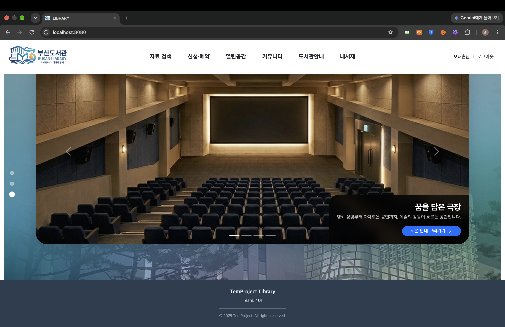
> `base.html` 공통 레이아웃: 헤더 메뉴(로그인 시 **내서재** 메뉴 노출), 로그인 정보, 푸터

---

## 🛠 사용 기술

| 구분 | 기술 |
|------|------|
| Backend | Java 17, Spring Boot 3.5 |
| ORM / Query | Spring Data JPA (Hibernate), JPQL, **QueryDSL 5.0** |
| 외부 API | **네이버 책 검색 API** (RestTemplate + Jackson) |
| Frontend | Thymeleaf + Layout Dialect, JavaScript (ES6, async/await), Axios, Bootstrap 5 |
| Database | MariaDB (Docker) |
| 기타 | Lombok, ModelMapper, JUnit 5, Gradle, Git/GitHub |

---

## ✨ 담당 기능

### 1. 도서 데이터 수집
- 네이버 책 검색 API로 받아온 도서 정보를 파싱해 `book` 테이블에 적재
- 적재 시 **초성 컬럼**(`ㄴㄹㅌ`)과 **정규화 컬럼**(특수문자 · 띄어쓰기 제거)을 함께 생성 → 검색 전용 데이터 확보

### 2. 검색 · 정렬 · 페이지네이션
- QueryDSL 동적 쿼리로 다중 필드 검색
- `CaseBuilder`로 가상 `priority` 컬럼을 만들어 **관련도 순 정렬**
  `제목 > 정규화 제목 > 초성 제목 > 저자 > 출판사 > 책 소개`
- 정렬: 최신 등록 / 출판일 / 제목 / 추천수 / 대출 빈도 (백엔드 5종 지원, 화면 메뉴에서는 새로들어온책 · 대출이많은책 · 추천하는책 3종 제공)
- `JPAExpressions` 서브쿼리로 **ISBN 단위 중복 제거** 후 페이지네이션

### 3. 검색어 하이라이트
- 리스트 · 상세 모달 모두에서 검색어를 `<mark>`로 표시
- 초성 검색어도 실제 글자 위치를 찾아 마킹 (`ㄴㄹㅌ` → **나루토**)

### 4. 성능
- 상세보기 데이터는 리스트를 받아올 때 함께 저장해 모달을 열 때 추가 요청 없음
- **N+1 문제 개선**: 루프 내 개별 조회 → ISBN `IN` 절 배치 조회, **쿼리 21개 → 5개 (76% 감소)**

### 5. 그 외
- 도서 추천(♡/♥), 찜하기, 대여 가능 여부 배지
- 대여 예약 로직: 같은 ISBN의 여러 복본에 **균등하게 배정**, 중복 예약 방지 (+ 단위 테스트)
- `base.html` 공통 레이아웃, `ControllerAdvice` 전역 예외 처리

---

## 🗄 DB 관계 (담당 기능 관련)

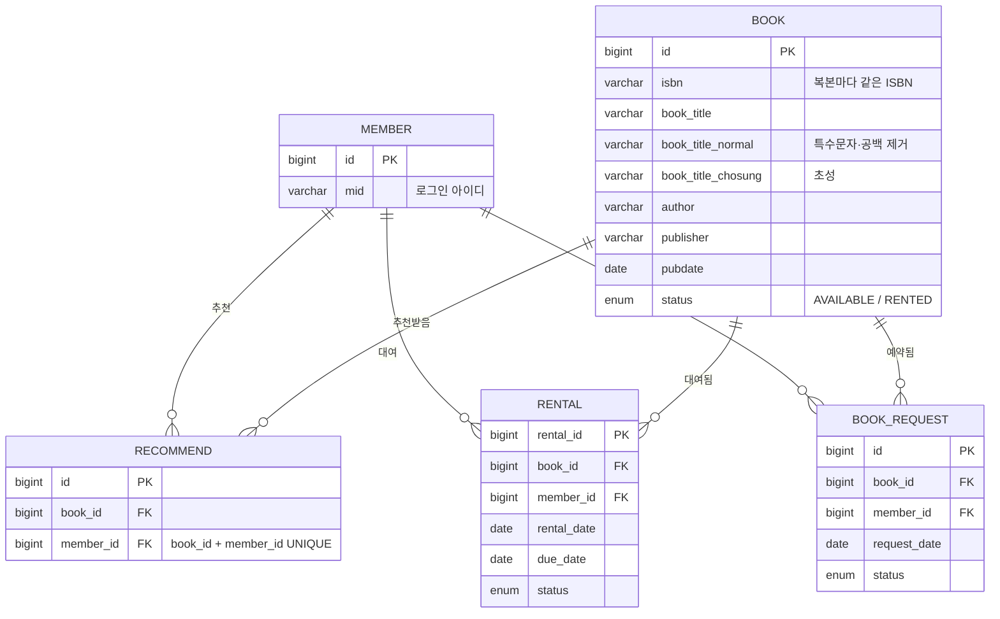

- **책 1권 = `book` 1행**이라, 같은 책의 복본은 같은 `isbn`으로 여러 행이 생김 → 리스트에서는 ISBN 단위로 묶어서 출력
- `book_title_normal`, `book_title_chosung`은 **검색 전용 컬럼**으로, 데이터를 적재할 때 `KoreanDecomposer`로 생성
- `recommend`는 `(book_id, member_id)` UNIQUE 제약으로 중복 추천을 막음

---

## 🐛 트러블슈팅

| 문제 | 원인 | 해결 |
|------|------|------|
| 책 표지가 비어서 나옴 | 국립중앙도서관 API의 표지 URL 누락 | 네이버 책 검색 API로 전환 |
| 정확히 같은 글자로만 검색됨 | 원본 제목 컬럼만 `LIKE` 검색 | 초성 · 정규화 컬럼 추가 후 우선순위 검색 |
| "데미안" 검색 시 "동물의세계"도 노출 | 일반 검색어에도 초성 매칭 적용 | 검색어가 **순수 초성일 때만** 초성 컬럼 검색 |
| 관련 없는 결과가 위로 섞임 | 매칭 필드와 상관없이 정렬 | CASE 기반 `priority` 컬럼을 정렬 기준에 추가 |
| 다른 복본에 중복 예약 가능 | 고정 `book_id` 기준 중복 체크 | ISBN + 상태값으로 `book_id`를 동적으로 탐색 |

---

## 📂 담당 주요 파일

| 계층 | 파일 |
|------|------|
| Controller | `BookController`, `BookRestController` |
| Service | `BookServiceImpl` |
| Repository | `BookSearchImpl` (QueryDSL), `BookRepository`, `RecommendRepository` |
| Utility | `KoreanDecomposer` (초성 추출 · 정규화) |
| Frontend | `templates/book/booklist.html`, `static/js/booklist.js`, `layout/base.html` |

> 📖 조회 흐름도, 검색 처리 흐름, N+1 개선 상세는 **[BOOK.md](BOOK.md)** 참고

---

## 🏛 프로젝트 전체 기능 (팀)

회원 관리 · 도서 리스트/검색 · 대출/반납 · 행사/이벤트 · 공지사항 · Q&A · 비치희망도서 신청 · 시설 예약 · 도서관 정보 · 관리자 페이지

---

## ▶ 실행 방법

```bash
# 1. MariaDB 준비 후 src/main/resources/application.properties의 DB 정보 수정
# 2. 실행
./gradlew bootRun
# 3. http://localhost:8080 접속
```
